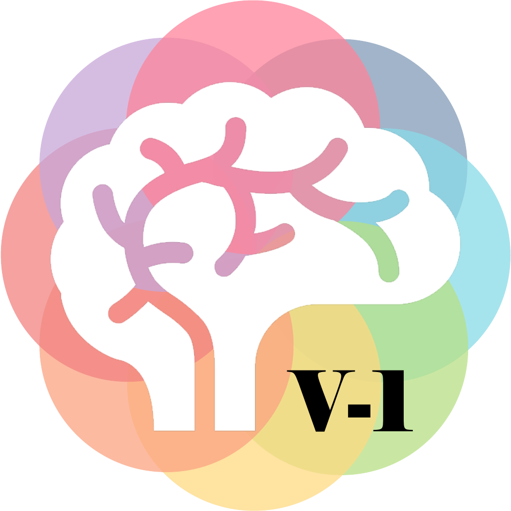
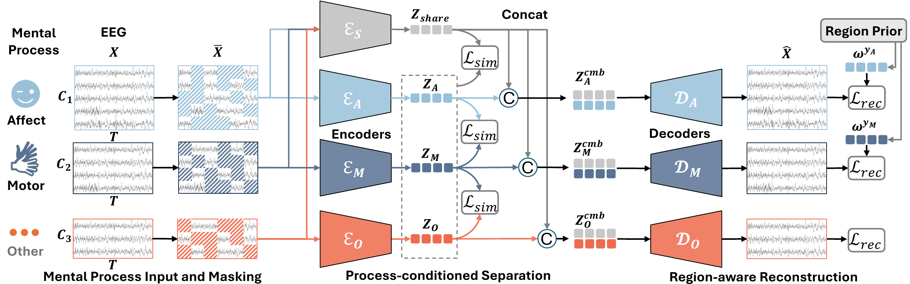

<p align="center">
  
</p>

<h1 align="center">BrainPro</h1>

<p align="center">
  <strong>Process-conditioned Pretraining with Topographic Retrieval for Large EEG Models</strong><br>
  <strong>Accepted at NeurIPS 2026</strong>
</p>

<p align="center">
  <a href="https://arxiv.org/abs/2509.22050"></a>
  
  <a href="https://huggingface.co/dycs/BrainPro-V1"></a>
  <a href="LICENSE-CBCR"></a>
</p>

<p align="center">
  <a href="#news">News</a> ·
  <a href="#how-it-works">Overview</a> ·
  <a href="#installation">Installation</a> ·
  <a href="#pre-training-merged-recordings-to-training-hdf5">Pre-training</a> ·
  <a href="#fine-tune-and-evaluate">Benchmarks</a> ·
  <a href="#use-brainpro-on-your-own-dataset">Custom datasets</a> ·
  <a href="#citation-and-licensing">Citation</a>
</p>

BrainPro learns shared and process-specific EEG representations for downstream decoding across emotion, motor, speech, mental arithmetic, depression, and attention tasks. This repository contains BrainPro-base pre-training, preprocessing and fine-tuning for nine benchmarks, and a standalone model for integration into your own pipeline.

Read the [paper on arXiv](https://arxiv.org/abs/2509.22050). The linked preprint currently uses the earlier title, *BrainPro: Towards Large-scale Brain State-aware EEG Representation Learning*.

## News

- **Checkpoint available:** Download [BrainPro-base on Hugging Face](https://huggingface.co/dycs/BrainPro-V1).
- **2026:** BrainPro has been accepted at **NeurIPS 2026**!
- **Included in this release:** BrainPro-base pre-training, nine downstream benchmark pipelines, and the standalone [BrainPro_v1.py](BrainPro_v1.py) interface.

<!-- Add future release notes above, newest first: **YYYY-MM-DD:** Describe the release and link to its tag, checkpoint, or documentation. -->

Run the commands below from this repository's root. Command-line entry points are at the root; training, preprocessing, and dataset-loading implementations are under `script/`.

## How it works

BrainPro combines temporal encoding with spatial filters retrieved using channel and region identities. Pre-training uses one shared encoder and process-associated encoders for affective (0), motor (1), and other (2) EEG. Masked reconstruction and a representation-separation loss train the model. Downstream classification uses the shared encoder, a selected process encoder, and a task-specific classifier.

The pre-training model factory is `brainpro_base`; the downstream factory is `BrainPro`. Fine-tuning loads pretrained encoder weights and reinitializes temporal position embeddings.

<p align="center">
  <a href="assets/brainpro-framework.pdf"></a>
</p>

*Pre-training overview.* Masked EEG is routed through a shared encoder and process-specific encoders. Representation separation and region-aware reconstruction guide learning. For downstream tasks, the shared encoder and one selected process encoder feed a task-specific classifier. [Open the vector figure](assets/brainpro-framework.pdf).


```text
brainpro/
├── README.md
├── requirements.txt
├── BrainPro_v1.py                # Standalone fine-tuning model; no timm registry
├── assets/                       # README logo and framework figure
├── configs/
│   ├── pretraining_data.json     # Input corpus filenames and process categories
│   ├── pretraining.json          # Pre-training hyperparameters
│   └── downstream.json           # Downstream benchmark hyperparameters
├── checkpoints/
│   └── brainpro-base.pth         # Place the pretrained checkpoint here
├── prepare_pretraining.py        # Corpus HDF5 files -> training HDF5 + metadata
├── pretrain.py                   # BrainPro-base pre-training
├── preprocess_downstream.py      # Raw downstream datasets -> LMDB
├── finetune.py                   # Fine-tuning, validation selection, test evaluation
└── script/
    ├── models/BrainPro/BrainPro.py
    ├── channels.py              # Channel definitions, aliases, and alignment
    ├── pretraining_data.py      # Pre-training dataset builder and loader
    ├── engine_pretraining.py
    ├── engine_downstream.py
    ├── optim_factory.py
    ├── utils.py
    ├── dataset_downstream/
    └── preprocessing_downstream/
```

## Installation

Training and evaluation require a CUDA GPU. HDF5 preparation and downstream preprocessing run on the CPU.

```bash
conda create -n brainpro python=3.11
conda activate brainpro
python -m pip install torch==2.1.0 torchvision==0.16.0 \
  --index-url https://download.pytorch.org/whl/cu121
python -m pip install -r requirements.txt
python -c "import torch; print(torch.__version__, torch.cuda.is_available())"
export MKL_THREADING_LAYER=GNU
mkdir -p data checkpoints outputs
```

`MKL_THREADING_LAYER=GNU` avoids the Intel MKL/libgomp conflict when spawning data-loader workers; set it in each new training shell.

## Pre-training: merged recordings to training HDF5

### Input format and configuration

The data preparation consists of **two steps**. First, convert the raw EEG recordings into HDF5 format following LaBraM conventions: preserve continuous EEG signals, resample to **200 Hz**, apply a **0.1–75 Hz bandpass filter**, convert amplitudes to **microvolts (µV)**, and store them as **float32** to save space. Second, merge the converted recordings into **one HDF5 corpus file per dataset and montage** to facilitate efficient pre-training.

All recordings within one corpus file must share the same mapped channel set. Split different montages into separate files and list each file in `configs/pretraining_data.json`. The builder starts from converted recordings; it does not perform raw-recording filtering, resampling, or unit conversion.

Each corpus must have this structure:

```text
corpus.hdf5
├── recording_001/
│   └── eeg                     # numeric [channels, time_samples]
│       └── attribute: chOrder  # ordered string array of electrode names
├── recording_002/
│   └── eeg
└── ...
```

Recording group names are arbitrary. `chOrder` must have one entry per row. Put the converted HDF5 files into this folder (`/path/to/recordings_to_merge` which will be set to `--input-dir`).


For the merged H5 file, the builder applies the defined alias mapping, removes unsupported electrodes, and prioritizes a canonical electrode over a duplicate alias. 
Edit `configs/pretraining_data.json` to match the files you have, relative to `--input-dir`. Keep all three category keys:

```json
{
  "AFFCT": ["seed-sleep.hdf5"],
  "MOTOR": ["grasplifteeg.hdf5"],
  "OTHER": ["restingstate.hdf5"]
}
```

Category IDs are always AFFCT=0, MOTOR=1, OTHER=2, regardless of JSON key order. Corpus IDs follow the order of files in those categories. Do not assign a downstream validation/test dataset to the pre-training corpus.

```bash
python prepare_pretraining.py \
  --config configs/pretraining_data.json \
  --input-dir /path/to/recordings_to_merge \
  --output data/pretraining.h5 \
  --metadata data/pretraining_metadata.pkl
```

The builder streams 10-second windows (2,000 samples; default stride 2,000), maps them to the checkpoint's fixed 60-channel order, and appends channel and region IDs. It drops windows with nonfinite values or absolute amplitude above 1,000 µV. Short recordings produce no windows.

Outputs:

- `pretraining.h5`: `eeg` float32 `[N,60,2002]`, `labels` int32 `[N,2]` containing corpus and process IDs, and the `chOrder` attribute. The last two values of each channel row hold its channel and region IDs; absent channels are zero padded.
- `pretraining_metadata.pkl`: canonical channels, spatial groups, importance masks, corpus configuration, and process labels. Keep this file paired with its HDF5 file.

Channel definitions and aliases are in `script/channels.py`. Do not change the canonical channel ordering for an existing checkpoint. The training engine removes padded channels and divides EEG amplitudes by 100 (following LaBraM); do not pre-apply that normalization to the source recordings.

`configs/pretraining_data.json` lists the input HDF5 corpus files and their
process categories. `configs/pretraining.json` contains pre-training
hyperparameters and is loaded automatically by `pretrain.py`. Explicit
command-line arguments override its values. Use `--config` to select another
pre-training hyperparameter file.

`configs/downstream.json` contains common downstream settings and
dataset-specific overrides. `finetune.py` loads this file automatically and
saves the resolved settings as `config_seed<seed>.json` alongside the
fine-tuned checkpoints.

### Run pre-training

Multi-GPU pre-training:

```bash
export MKL_THREADING_LAYER=GNU
CUDA_VISIBLE_DEVICES=0,1,2,3,4 torchrun \
  --standalone --nnodes=1 --nproc_per_node=5 \
  pretrain.py \
  --model brainpro_base \
  --merged_pretraining_data_path data/pretraining.h5 \
  --meta_data_path data/pretraining_metadata.pkl \
  --batch_size 32 \
  --epochs 30 \
  --warmup_epochs 2 \
  --lr 1e-4 \
  --opt_betas 0.9 0.98 \
  --clip_grad 3 \
  --num_workers 4 \
  --save_ckpt_freq 1 \
  --output_dir outputs/pretrain_base
```

Single-GPU training:

```bash
export MKL_THREADING_LAYER=GNU
CUDA_VISIBLE_DEVICES=0 python pretrain.py \
  --model brainpro_base \
  --merged_pretraining_data_path data/pretraining.h5 \
  --meta_data_path data/pretraining_metadata.pkl \
  --batch_size 160 \
  --epochs 30 \
  --warmup_epochs 2 \
  --lr 1e-4 \
  --opt_betas 0.9 0.98 \
  --clip_grad 3 \
  --num_workers 4 \
  --save_ckpt_freq 1 \
  --output_dir outputs/pretrain_base_single_gpu
```

The manuscript used a global batch of 160 (five GPUs × 32); the single-GPU command above has a global batch of 160. The preserved loader requires at least one worker and drops incomplete batches. Do not set a warmup longer than the total run.

Pre-training updates `checkpoint.pth` each epoch, writes numbered `checkpoint-<epoch>.pth` files at `--save_ckpt_freq`, and appends epoch metrics to `log.txt` in `--output_dir`. Epoch numbers start at zero. To resume, pass `--resume /path/to/checkpoint.pth`; pass `--no_auto_resume` if you don't want the automatic-resume behavior. Use a fresh output directory for a new run.

## Downstream preprocessing

Obtain data from its original providers. Use these input folders with `--raw-dir`; no source edits are required:

| Dataset | Expected contents of raw directory | Channels | Window | Expected samples |
|---|---|---:|-------:|---:|
| FACED | `sub*.pkl` from `EMO_FACED/Processed_data` | 32 |   10 s | 10,332 |
| SEED-V | `.cnt` files from `EMO_SEED_V/EEG_raw` | 62 |    1 s | 117,744 |
| BCI-IV-2A | `A*.mat` from `MI_BCIC_IV2a_mat` | 22 |    4 s | 5,088 |
| SHU | `S01/d*.mat` through `S25/` | 32 |    4 s | 11,988 |
| MentalArithmetic | `Subject*.edf` from the MWL dataset | 20 |    4 s | 1,080 |
| ATTEN | `VP001/gonogo1.vhdr` and companion files, 26 subjects × 3 sessions | 28 |    4 s | 4,680 |
| SEED-VII | Per-subject `.mat` files containing `eeg_1` through `eeg_80` from `EMO_SEED_VII/Preprocessed_EEG` | 62 |    1 s | 281,679 |
| Speech | `Training set/` and `Validation set/` containing the supplied EEG `.mat` files | 64 | 800 samples* | 5,250 |
| Mumtaz2016 | Healthy and MDD subjects’ EC/EO `.edf` files in the raw directory; TASK recordings excluded | 19 |    4 s | 8,860 |

*Speech retains the evaluated handling: each 795-sample trial is zero-padded to 800 samples and arranged into four 200-sample blocks. This does not resample the original trial into a true four-second recording.

```bash
python preprocess_downstream.py FACED --raw-dir /path/to/EMO_FACED/Processed_data --output-dir data/FACED
python preprocess_downstream.py SEED-V --raw-dir /path/to/EMO_SEED_V/EEG_raw --output-dir data/SEED-V
python preprocess_downstream.py BCI-IV-2A --raw-dir /path/to/MI_BCIC_IV2a_mat --output-dir data/BCI-IV-2A
python preprocess_downstream.py SHU --raw-dir /path/to/MI_ShanghaiU --output-dir data/SHU
python preprocess_downstream.py MentalArithmetic --raw-dir /path/to/MWL --output-dir data/MentalArithmetic

# ATTEN requires decoding/filtering/ICA before segmentation.
python preprocess_downstream.py decode_attention --raw-dir /path/to/ATTEN --output-dir data/ATTEN_decoded
python preprocess_downstream.py ATTEN --raw-dir data/ATTEN_decoded --output-dir data/ATTEN

python preprocess_downstream.py SEED-VII --raw-dir /path/to/EMO_SEED_VII/Preprocessed_EEG --output-dir data/SEED-VII
python preprocess_downstream.py Speech --raw-dir /path/to/CS_BCIC_Speech --output-dir data/Speech
python preprocess_downstream.py Mumtaz2016 --raw-dir /path/to/MDD_Mumtaz --output-dir data/Mumtaz2016
```

Use an empty output directory separate from the input directory. The output is an LMDB dataset with fixed train/validation/test key lists.

## Fine-tune and evaluate

The pretrained **BrainPro-base** checkpoint is available on
[Hugging Face](https://huggingface.co/dycs/BrainPro-V1).
Download it into `checkpoints/` from the repository root:

```bash
mkdir -p checkpoints
curl -L --fail \
  https://huggingface.co/dycs/BrainPro-V1/resolve/main/brainpro-base.pth \
  -o checkpoints/brainpro-base.pth
```

Alternatively, [download the checkpoint directly](https://huggingface.co/dycs/BrainPro-V1/resolve/main/brainpro-base.pth)
and save it as `checkpoints/brainpro-base.pth`.

Run one benchmark and seed:

```bash
python finetune.py BCI-IV-2A \
  --data-dir data/BCI-IV-2A \
  --checkpoint checkpoints/brainpro-base.pth \
  --output-dir outputs/downstream --seed 0 --gpu 0 \
  2>&1 | tee outputs/bci42a_seed0.log
```

The runner fixes the evaluated settings from `configs/downstream.json`:

| Dataset | LR | T | Dropout | Token mode | Process branch | Epochs |
|---|---:|---:|---:|---|---------------:|---:|
| FACED | 5e-4 | 8 | 0.1 | all |              0 | 50 |
| SEED-V | 3e-4 | 1 | 0.1 | all |              0 | 50 |
| BCI-IV-2A | 1e-3 | 1 | 0.2 | avg |              1 | 50 |
| SHU | 1e-4 | 1 | 0.1 | avg |              1 | 50 |
| MentalArithmetic | 1e-4 | 1 | 0.1 | mean |              0 | 50 |
| ATTEN | 1e-3 | 4 | 0.1 | avg |              0 | 30 |
| SEED-VII | 3e-4 | 8 | 0.1 | all |              0 | 50 |
| Speech | 3e-4 | 1 | 0.1 | mean |              2 | 50 |
| Mumtaz2016 | 1e-4 | 2 | 0.1 | avg |              0 | 50 |

Common settings: batch 64, AdamW, weight decay 0.05 (0.1 for Speech), gradient clipping 1, multiclass label smoothing 0.1, no warmup, and cosine minimum LR 1e-6. ATTEN trains for 30 epochs within a **50-epoch cosine cycle**, matching the reproduced appendix setting. Mental Arithmetic and ATTEN use process branch 0.

All seeds share `outputs/downstream/<dataset>/`. Configurations are named `config_seed0.json`, `config_seed1.json`, etc.; checkpoint filenames already include the seed. Console output includes epoch metrics and final test results; use `tee` to retain per-seed logs. Different seeds can use the same output directory. Re-running an existing seed requires a fresh output directory to avoid overwriting its results.

Run all nine datasets and five seeds sequentially:

```bash
export MKL_THREADING_LAYER=GNU
mkdir -p outputs
set -o pipefail

for dataset in FACED SEED-V BCI-IV-2A SHU MentalArithmetic ATTEN SEED-VII Speech Mumtaz2016; do
  for seed in 0 1 2 3 4; do
    python finetune.py "$dataset" \
      --data-dir "data/$dataset" \
      --checkpoint checkpoints/brainpro-base.pth \
      --output-dir outputs/downstream \
      --seed "$seed" \
      --gpu 0 \
      2>&1 | tee "outputs/${dataset}_seed${seed}.log" || exit 1
  done
done
```

`finetune.py` performs training, selects a checkpoint using validation
performance, and evaluates the selected checkpoint on the held-out test split. Final test metrics are printed
to the console; the commands above use `tee` to retain them in log files.


## Use BrainPro on your own dataset

Copy [BrainPro_v1.py](BrainPro_v1.py) into your project and import `BrainPro` directly.

### Prepare your inputs

- Supply EEG tensors shaped **`[batch, channels, time_samples]`**, sampled at **200 Hz**. The channel dimension must follow the exact order of `channel_names`.
- Use a fixed window length: `n_times` must be a multiple of 20. 
- Use consistent units and preprocessing. The release's downstream loaders divide their processed EEG values by **100** before model input. Apply this scaling exactly once when matching that protocol; the standalone model does not filter, resample, or normalize inputs. For custom raw data in volts, convert to microvolts before applying your chosen preprocessing and input scaling.
- Use canonical electrode names from `predefined_channels` (case-insensitive). Unsupported electrodes are reported and discarded inside the model; at least one supported non-midline electrode is required.

### Build a classifier without a registry

This example uses a custom six-channel, four-class motor dataset with four-second windows. Replace the channel list, class count, and branch with those appropriate for your data.

```python
import torch
from BrainPro_v1 import BrainPro

torch.manual_seed(0)
device = torch.device("cuda" if torch.cuda.is_available() else "cpu")

model_config = dict(
    channel_names=["F3", "F4", "C3", "C4", "P3", "P4"],
    n_times=800,             # 4 seconds at 200 Hz
    n_classes=4,
    branch=1,                # 0: affective, 1: motor, 2: other
    mode="all",
    hidden_factor=1,
    dropout=0.2,
)

model = BrainPro(
    **model_config,
    checkpoint="checkpoints/brainpro-base.pth",
    checkpoint_kind="pretrained",
).to(device)

# Synthetic input only to demonstrate the interface; replace with processed EEG.
eeg = torch.randn(2, 6, 800, device=device)
model.eval()
with torch.no_grad():
    logits = model(eeg)      # [2, 4]; no softmax is applied
```

For an existing benchmark, use its channel list from `CHANNELS`, for example `from BrainPro_v1 import CHANNELS` and `channel_names=CHANNELS["BCI-IV-2A"]`. Match the other settings to `configs/downstream.json` when reproducing that benchmark.

| Argument | Meaning |
|---|---|
| `branch` | Process encoder used alongside the shared encoder: `0` affective, `1` motor, `2` other. For a new task, choose using domain knowledge and validation data. |
| `mode` | `mean`: average all temporal tokens; `avg`: average groups of five tokens and concatenate; `all`: concatenate every temporal token. `avg` requires `n_times` to be a multiple of 100. |
| `hidden_factor` | The benchmark table's `T`; sets the first MLP hidden width to `hidden_factor * 200`. |
| `n_classes` | Number of output logits. Use `1` with binary cross-entropy for binary classification. |
| `linear_head` | Defaults to `False` (MLP head). Set `True` for a linear classification head. |
| `freeze_encoders` | Defaults to `False`. Set `True` to disable encoder gradients. Encoder dropout still follows `model.train()` / `model.eval()`. |

Loading a pre-training checkpoint restores encoder weights and resets temporal position embeddings, matching the release fine-tuning initialization. The classifier is initialized for your task. With `checkpoint=None`, the model starts from random initialization.


## Citation and licensing

```bibtex
@inproceedings{ding2026brainpro,
  title={BrainPro: Process-conditioned Pretraining with Topographic Retrieval for Large EEG Models},
  author={Ding, Yi and Jiang, Muyun and Jiang, Weibang and Zhang, Shuailei and Zhou, Xinliang and Liu, Chenyu and Li, Shanglin and Li, Yong and Guan, Cuntai},
  booktitle={Advances in Neural Information Processing Systems},
  year={2026}
}
```

### CBCR License

BrainPro's original code is released under the [CBCR License 1.0](LICENSE-CBCR).

| Permissions | Limitations | Conditions |
|---|---|---|
| Noncommercial use, modification, and redistribution | Commercial use is not permitted under this license | Retain copyright notices, license conditions, and disclaimers; no endorsement using the copyright holder's or contributors' names without prior written permission |

Third-party code retains its original copyright notices and applicable license terms. Dataset access and redistribution remain governed by their providers.

## Acknowledgements

We thank the authors of [LaBraM](https://github.com/935963004/LaBraM)
and [CBraMod](https://github.com/wjq-learning/CBraMod) for making their
code publicly available. Their implementations provided valuable
references for developing BrainPro and its experimental pipelines.